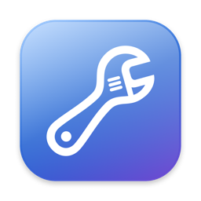
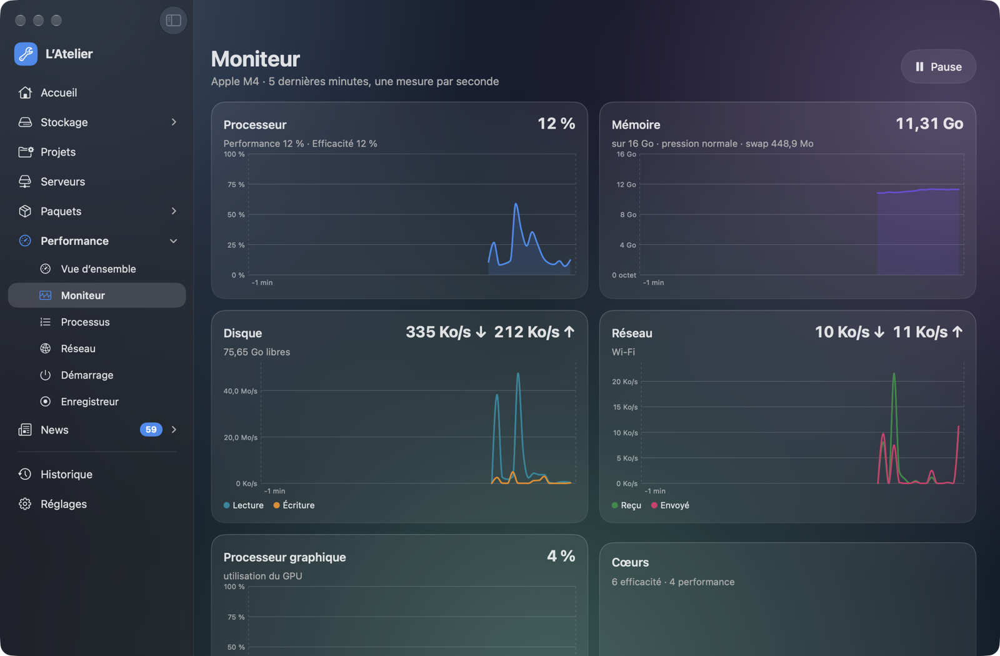
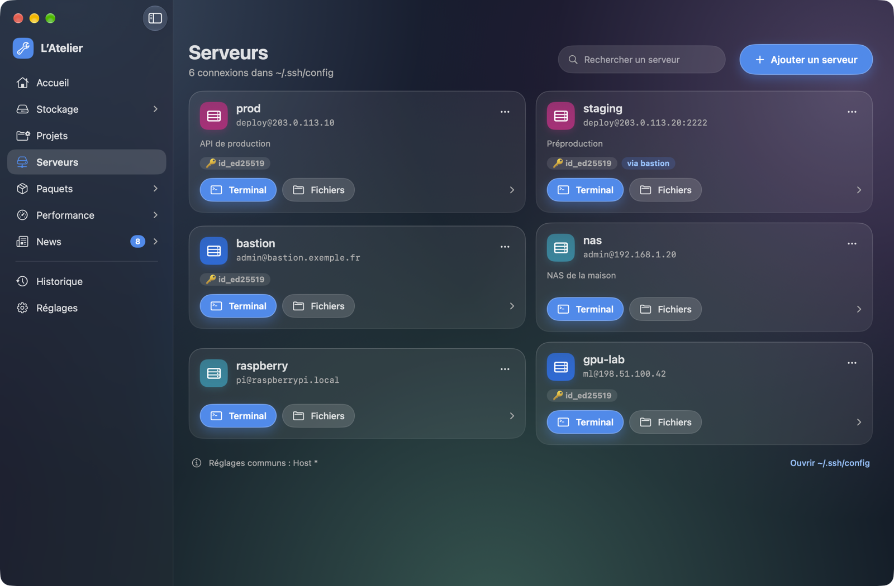
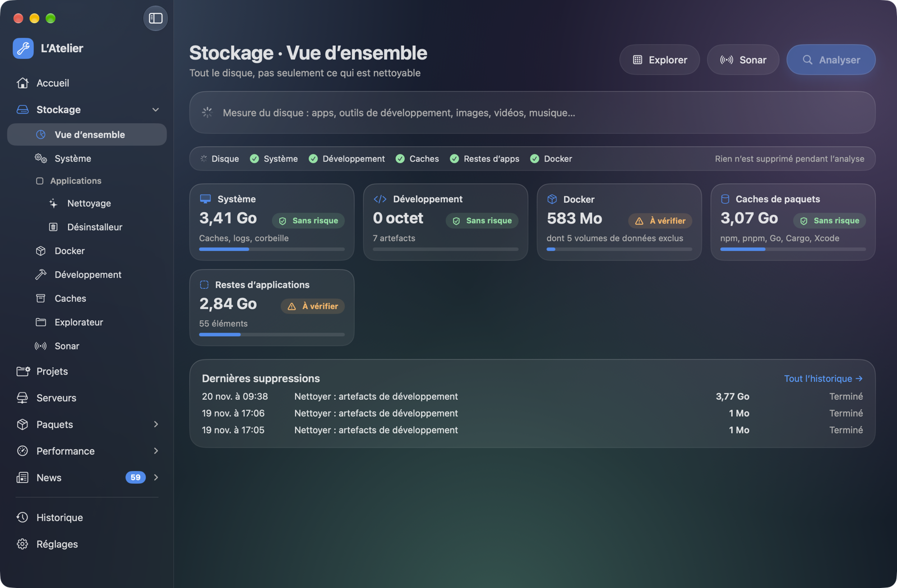

<div align="center">



# L’Atelier

<sub>**English** · [Français](README_fr.md)</sub>

**The macOS toolbox for developers: a clean, up-to-date and safe machine.**

Storage, git projects, packages, SSH servers, performance and security watch,<br>
in one native Liquid Glass app that never does anything without showing you what, how much, and how risky.

[](#installation)
[](Package.swift)
[](Sources/LAtelier)
[](#privacy)
[](LICENSE)
[](https://github.com/DIGYSKY/latelier/releases/latest)

[Installation](#installation) · [Features](#features) · [Safety](#safety-rules) · [Updates](#updates) · [Building](#building-from-source)

<br>



</div>

---

## Why L’Atelier?

A developer’s machine gets cluttered fast: forgotten `node_modules`, orphaned Docker images,
gigabytes of package caches, vulnerable dependencies in old projects, overdue updates. Noticing
it all takes a dozen tools and as many commands.

L’Atelier brings it together in **one native app**, built around a single principle:

> **No action until you have seen what, how much, and whether it is safe.**

Every deletion, update or command goes through a **preview**. What is removed goes **to the Trash**
by default, and everything is recorded in a searchable **history**.

> *L’Atelier* is French for “the workshop”. The app is available in English and French.

## Features

<table>
<tr>
<td width="50%" valign="top">

### 🗄️ Storage
- **Overview** of the whole disk, category by category, down to what “Other” really is.
- **Development**: `node_modules`, `target`, `.build`, `DerivedData`… of inactive projects.
- Package **caches** (npm, pnpm, Homebrew, pip, Cargo, Gradle…), cleared with each tool’s official command.
- **Docker**: images, containers, volumes and build cache, image by image.
- **Applications**: leftovers of deleted apps, and a complete uninstaller.
- **Sonar**: the largest files and duplicates, on a radar.
- **Explorer**: where the space goes, folder by folder.

</td>
<td width="50%" valign="top">

### 🧩 Projects
- All your **git repositories**, sorted by activity, with a page for each.
- **Git**: changes, unpushed commits, fetch.
- Detected **commands** (`package.json`, `Makefile`, `docker-compose`…), run in one click.
- Outdated **dependencies** and **vulnerabilities** (OSV.dev, GitHub Advisories).
- **Committed secrets**, found locally.
- **Test coverage**, including installing the missing tool.
- Open in **Claude Code**, your terminal or your editor.

</td>
</tr>
<tr>
<td valign="top">

### 🖥️ Servers
- The connections in **`~/.ssh/config`**: add, edit, duplicate or delete them without losing anything else in the file.
- **One-click terminal** in Terminal, iTerm, Ghostty or Warp.
- **Monitor** with nothing to install: CPU, memory, disks, network, processes, systemd services, Docker containers and ports, with actions (stop a process, restart a service…).
- **Remote file browser**, cloud-drive style: grid or list, drag and drop to upload, download, rename, create folders.
- **Edit a server file** in the built-in editor or your own. Saving is refused if the file changed in the meantime.
- Deletion goes to a **trash on the server**.

</td>
<td valign="top">

### 📦 Packages
- **Inventory** of Homebrew, npm, pnpm, pip, pipx, Cargo, gem…
- **Updates** sorted by gap (patch, minor, major).
- **Runtimes** (Node, Python, Ruby…) and their end-of-life versions.
- Homebrew **services**: start, stop, restart.

### ⚡ Performance
- A large **monitor**: CPU (performance and efficiency cores), memory, disk, network, GPU, energy.
- **Processes** grouped by app, with a detailed sheet for each.
- **Listening ports**, openable and copyable.
- **Login items** and background agents.

</td>
</tr>
<tr>
<td valign="top">

### 📰 News
- News about **your languages and tools**, and **security** (CISA KEV, GitHub Advisories…).
- Matched against what is installed: an advisory that affects you takes you **where it can be fixed**.

</td>
<td valign="top">

### 🧭 Everywhere
- A **history** of every action, with command output and an explanation of failures.
- **Menu bar extra**: live resources, busiest processes, alerts.
- **Dark mode**, transparency settings, English or French (the system language by default).

</td>
</tr>
</table>

<div align="center">


</div>

## Installation

> [!NOTE]
> L’Atelier requires **macOS 26 (Tahoe) or later**, on an Apple silicon Mac.

### Option 1: build it on your Mac (recommended)

One command. It installs the latest release into `/Applications`:

```bash
curl -fsSL https://raw.githubusercontent.com/DIGYSKY/latelier/main/install.sh | bash
```

The script checks the prerequisites: Apple’s Command Line Tools, which macOS offers to install
if they are missing (Xcode is not needed). It then fetches the sources into `~/.latelier/source`,
builds and installs the app.

**An app built on your own Mac shows no security warning.** You can [read the script](install.sh)
before running it: it is about a hundred lines.

### Option 2: download the disk image

1. Download `LAtelier-x.y.z.dmg` from the [latest release](https://github.com/DIGYSKY/latelier/releases/latest).
2. Open it and drag **L’Atelier** to **Applications**.
3. On first launch, macOS says the app “cannot be verified”. Open
   **System Settings › Privacy & Security**, then click **Open Anyway**.

<details>
<summary><b>Why this warning?</b> And the one-command alternative</summary>

<br>

L’Atelier is an independent project, distributed outside the App Store and without a paid Apple
Developer membership. The app is signed, but not notarized by Apple, so Gatekeeper asks for your
consent once, on first launch.

If you prefer the Terminal, this command removes the quarantine flag set on the download:

```bash
xattr -dr com.apple.quarantine "/Applications/L’Atelier.app"
```

You can check the file’s integrity with the checksum published next to the `.dmg`:

```bash
shasum -a 256 -c LAtelier-x.y.z.dmg.sha256
```

</details>

### First launch

A short welcome walks you through the few settings that matter. To measure the whole disk (the
Trash, some apps’ data), L’Atelier needs **Full Disk Access**:
**System Settings › Privacy & Security › Full Disk Access**, then add L’Atelier.

This access is optional: without it, L’Atelier works and simply tells you what it could not measure.

> [!NOTE]
> L’Atelier is in **beta** (`1.0.0-beta`). Your feedback matters: **Settings › About › Report a Problem**, or open an [issue](https://github.com/DIGYSKY/latelier/issues).

## Updates

L’Atelier checks **once a day** whether a new version has been published in the
[GitHub releases](https://github.com/DIGYSKY/latelier/releases). You can also check from
**Settings › About › Check for Updates**, or turn it off.

When a version is available, a banner appears on the Home screen. **Update…** first previews the
steps, then:

| Installed with | The update… |
|---|---|
| `install.sh` | fetches the **release tag** into the sources, **rebuilds** on your Mac and replaces the app |
| the disk image | downloads the `.dmg`, checks its **SHA-256 checksum**, checks that it is **signed with the same certificate** as the installed version, and replaces the app |

The new version is prepared next to the current one and verified before the swap. If anything
fails, the current version stays in place; otherwise it goes **to the Trash** and L’Atelier
relaunches on its own. Your settings, history and permissions (Full Disk Access) are kept.

A copy that is not signed with the project’s certificate (an ad hoc build) does not update from
the disk image, since it could not verify the author. Reinstall it with `install.sh`.

## Safety rules

L’Atelier touches your disk, your repositories and your servers. Seven rules apply to every
screen, without exception:

1. **A preview is mandatory** before any deletion, update or command that changes something.
2. **The Trash by default**. Permanent deletion stays an option. On an SSH server, the trash is `~/.latelier-corbeille`.
3. **Nothing in use is touched**: an open app, a running container, a repository in the middle of a git operation.
4. **Never a system path**. Administrator actions require explicit authorization.
5. **Everything is logged** in the History: what, when, how much, and each command’s output.
6. **Errors are visible**: a partial operation is reported, never hidden. Common failures are explained, with the fix.
7. **Minimal networking** (see below).

## Privacy

**L’Atelier sends no telemetry and no statistics.** It only contacts:

| Destination | For | What is sent |
|---|---|---|
| Package registries (npm, PyPI, crates.io…) | available versions | package names |
| OSV.dev, GitHub Advisories | known vulnerabilities | package names and versions (can be turned off) |
| News sources | news | nothing (RSS feeds are read) |
| GitHub Releases | new versions of L’Atelier | nothing (can be turned off) |
| Your SSH servers | monitor, file browser, terminal | only when you open them |

No code, path, project name or secret ever leaves your Mac. Committed-secret detection is
entirely local.

## Building from source

All you need is **Apple’s Command Line Tools** (`xcode-select --install`). Xcode is not required.

```bash
git clone https://github.com/DIGYSKY/latelier.git
cd latelier
make run        # builds build/L’Atelier.app and opens it
```

| Command | Purpose |
|---|---|
| `make app` | builds `build/L’Atelier.app` (release mode) |
| `make run` | builds and launches |
| `make test` | runs the tests (Swift Testing) |
| `make smoke` | opens the real app on every screen and checks it does not crash |
| `make install` | builds and installs into `/Applications` |
| `make cert` | creates a self-signed signing certificate (see below) |
| `make dmg` | produces `build/LAtelier-<version>.dmg` and its `.sha256` |
| `make release` | publishes the version in `VERSION` on GitHub (tag, `.dmg`, `.sha256`) |

<details>
<summary><b>Signing and app identity</b></summary>

<br>

macOS ties permissions (Full Disk Access…) to an app’s **signing identity**. With an ad hoc
signature, that identity changes with every build, and macOS forgets your permissions on every
update.

`make cert` creates, once and for all, a self-signed certificate, “L’Atelier Self-Signed”, in your
login keychain. `make app` then uses it automatically, and the built-in updater checks that every
new version is signed with that same certificate. **Back up the `.p12` file** created in
`~/.latelier-signing`: losing it means changing identity.

With an Apple Developer account, notarization also removes the first-launch warning:

```bash
SIGN_IDENTITY="Developer ID Application: Name (TEAMID)" NOTARY_PROFILE="latelier" make dmg
```

</details>

<details>
<summary><b>Architecture</b></summary>

<br>

```
Sources/
├── LAtelierCore/     Pure logic, no UI, fully tested:
│                     scanners, commands, previews (ActionPlan), history,
│                     safeguards (SafetyGuard), ssh_config, updates…
└── LAtelier/         The SwiftUI app: observable model, pages, Liquid Glass components
Tests/LAtelierCoreTests/   Swift Testing
scripts/              app bundle, disk image, certificate, release, smoke test
```

- **No third-party dependencies**: Apple frameworks only.
- Commands run without a shell (`Process`), with escaped arguments.
- Every action is an `ActionPlan`: shown in the preview, executed step by step, then recorded in the history.

</details>

## Contributing

Feedback and contributions are welcome: see the [contributing guide](CONTRIBUTING.md).
Found a security issue? No public issue, please: follow the [security policy](SECURITY.md).
Changes in each version are listed in the [changelog](CHANGELOG.md).

## License

L’Atelier is free software, released under the [GNU GPL v3](LICENSE). You may use, study, modify
and redistribute it, as long as you keep the same license. It comes with no warranty.

<div align="center">
<br>
<sub>Made with care for developers on the Mac · <b>L’Atelier</b></sub>
</div>
