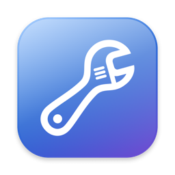
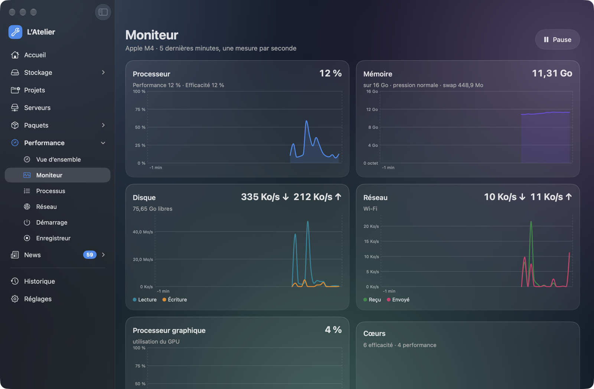
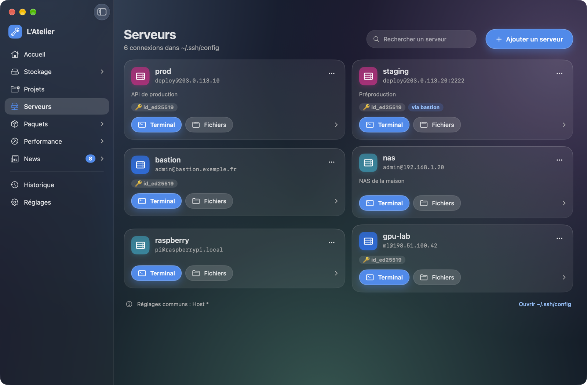
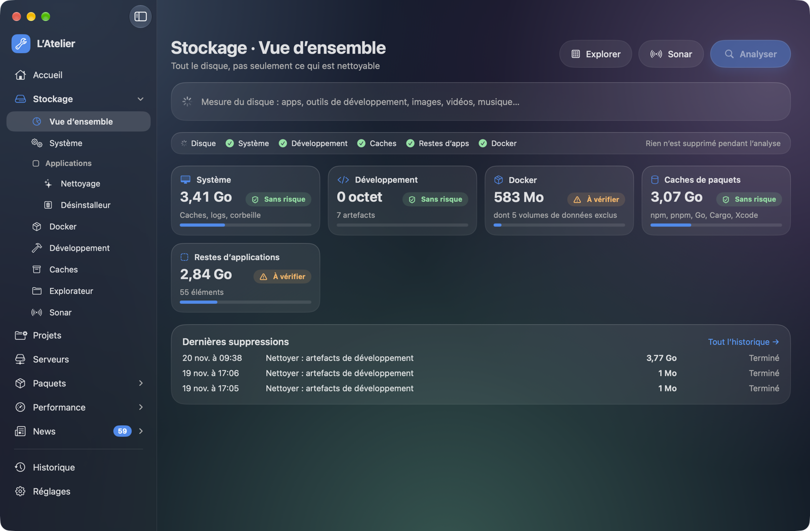

<div align="center">



# L’Atelier

<sub>[English](README.md) · **Français**</sub>

**La boîte à outils macOS des développeurs : une machine propre, à jour et sûre.**

Stockage, projets git, paquets, serveurs SSH, performances et veille sécurité,<br>
réunis dans une app native en Liquid Glass, qui ne fait jamais rien sans vous montrer quoi, combien et avec quel risque.

[](#installation)
[](Package.swift)
[](Sources/LAtelier)
[](#confidentialité)
[](LICENSE)
[](https://github.com/DIGYSKY/latelier/releases/latest)

[Installation](#installation) · [Fonctionnalités](#fonctionnalités) · [Sécurité](#les-règles-de-sécurité) · [Mises à jour](#mises-à-jour) · [Compiler](#compiler-depuis-les-sources)

<br>



</div>

---

## Pourquoi L’Atelier ?

Une machine de développeur s’encrasse vite : des `node_modules` oubliés, des images Docker
orphelines, des caches de paquets de plusieurs gigaoctets, des dépendances vulnérables dans
d’anciens projets, des mises à jour en retard. Il faut une dizaine d’outils et autant de commandes
pour s’en rendre compte.

L’Atelier rassemble tout cela dans **une seule app native**, pensée autour d’un principe :

> **Aucune action sans que vous ayez vu quoi, combien, et si c’est sans risque.**

Chaque suppression, mise à jour ou commande passe par un **aperçu**. Ce qui part va **à la corbeille**
par défaut, et tout est consigné dans un **historique** consultable.

## Fonctionnalités

<table>
<tr>
<td width="50%" valign="top">

### 🗄️ Stockage
- **Vue d’ensemble** du disque entier, catégorie par catégorie, jusqu’au détail de « Autres ».
- **Développement** : `node_modules`, `target`, `.build`, `DerivedData`… des projets inactifs.
- **Caches** de paquets (npm, pnpm, Homebrew, pip, Cargo, Gradle…), vidés par la commande officielle de chaque outil.
- **Docker** : images, conteneurs, volumes et cache de build, image par image.
- **Applications** : restes d’apps désinstallées, désinstalleur complet.
- **Sonar** : les plus gros fichiers et les doublons, sur un radar.
- **Explorateur** : où passe l’espace, dossier par dossier.

</td>
<td width="50%" valign="top">

### 🧩 Projets
- Tous vos **dépôts git**, triés par activité, avec une page par dépôt.
- **Git** : modifications, commits non poussés, fetch.
- **Commandes** détectées (`package.json`, `Makefile`, `docker-compose`…), lancées en un clic.
- **Dépendances** obsolètes et **failles** (OSV.dev, GitHub Advisories).
- **Secrets commités** repérés localement.
- **Couverture de tests**, avec l’installation de l’outil manquant.
- Ouverture dans **Claude Code**, votre terminal ou votre éditeur.

</td>
</tr>
<tr>
<td valign="top">

### 🖥️ Serveurs
- Les connexions de **`~/.ssh/config`** : ajouter, modifier, dupliquer ou supprimer, sans rien perdre du fichier.
- **Terminal en un clic** dans Terminal, iTerm, Ghostty ou Warp.
- **Moniteur** sans rien installer : processeur, mémoire, disques, réseau, processus, services systemd, conteneurs Docker et ports, avec les actions (arrêter un processus, redémarrer un service…).
- **Explorateur de fichiers distant**, façon stockage en ligne : grille ou liste, glisser-déposer pour importer, télécharger, renommer, créer un dossier.
- **Modifier un fichier** du serveur dans l’éditeur intégré ou dans le vôtre. L’envoi est refusé si le fichier a changé entre-temps.
- Suppression vers une **corbeille sur le serveur**.

</td>
<td valign="top">

### 📦 Paquets
- **Inventaire** de Homebrew, npm, pnpm, pip, pipx, Cargo, gem…
- **Mises à jour** classées par écart (correctif, mineure, majeure).
- **Runtimes** (Node, Python, Ruby…) et leurs versions en fin de vie.
- **Services** Homebrew : démarrer, arrêter, redémarrer.

### ⚡ Performance
- **Moniteur** en grand : processeur (cœurs performance et efficacité), mémoire, disque, réseau, GPU, énergie.
- **Processus** groupés par app, avec une fiche détaillée pour chacun.
- **Ports en écoute**, ouvrables et copiables.
- Programmes au **démarrage**.

</td>
</tr>
<tr>
<td valign="top">

### 📰 News
- L’actualité de **vos langages et outils**, et la **cybersécurité** (CISA KEV, GitHub Advisories…).
- Croisée avec ce qui est installé : un avis qui vous concerne vous mène **là où l’on corrige**.

</td>
<td valign="top">

### 🧭 Partout
- **Historique** de toutes les actions, avec la sortie des commandes et l’explication des échecs.
- **Menu dans la barre des menus** : ressources en direct, processus actifs, alertes.
- **Mode sombre**, réglages de transparence, et l’app en français ou en anglais (celle du système par défaut).

</td>
</tr>
</table>

<div align="center">


</div>

## Installation

> [!NOTE]
> L’Atelier demande **macOS 26 (Tahoe) ou plus récent**, sur un Mac Apple silicon.

### Option 1 : compiler sur votre Mac (recommandé)

Une seule commande. Elle installe la dernière version publiée dans `/Applications` :

```bash
curl -fsSL https://raw.githubusercontent.com/DIGYSKY/latelier/main/install.sh | bash
```

Le script vérifie les prérequis : les outils de ligne de commande d’Apple, que macOS propose
d’installer s’ils manquent (Xcode n’est pas nécessaire). Il récupère ensuite les sources dans
`~/.latelier/source`, compile et installe l’app.

**Une app compilée sur votre propre Mac n’affiche aucun avertissement de sécurité.** Avant de
lancer ce script, vous pouvez [le lire](install.sh) : il fait une centaine de lignes.

### Option 2 : télécharger l’image disque

1. Téléchargez `LAtelier-x.y.z.dmg` depuis la [dernière version](https://github.com/DIGYSKY/latelier/releases/latest).
2. Ouvrez-la et glissez **L’Atelier** dans **Applications**.
3. Au premier lancement, macOS indique que l’app « ne peut pas être vérifiée ». Ouvrez
   **Réglages Système › Confidentialité et sécurité**, puis cliquez sur **Ouvrir quand même**.

<details>
<summary><b>Pourquoi cet avertissement ?</b> Et l’alternative en une commande</summary>

<br>

L’Atelier est un projet indépendant, distribué hors de l’App Store et sans abonnement
au programme développeur d’Apple. L’app est donc signée, mais pas « notarisée » par Apple, et
Gatekeeper demande votre accord une fois, au premier lancement.

Si vous préférez le Terminal, cette commande retire la marque de quarantaine posée sur le téléchargement :

```bash
xattr -dr com.apple.quarantine "/Applications/L’Atelier.app"
```

Vous pouvez vérifier l’intégrité du fichier avec l’empreinte publiée à côté du `.dmg` :

```bash
shasum -a 256 -c LAtelier-x.y.z.dmg.sha256
```

</details>

### Premier lancement

Pour mesurer tout le disque (la corbeille, les données de certaines apps), L’Atelier a besoin
de l’**accès complet au disque** :
**Réglages Système › Confidentialité et sécurité › Accès complet au disque**, puis ajoutez L’Atelier.

Cet accès est facultatif : sans lui, L’Atelier fonctionne, et vous indique simplement ce qu’il n’a pas pu mesurer.

> [!NOTE]
> L’Atelier est en **bêta** (`1.0.0-beta`). Vos retours sont précieux : **Réglages › À propos › Signaler un problème**, ou une [issue](https://github.com/DIGYSKY/latelier/issues).

## Mises à jour

L’Atelier vérifie **une fois par jour** si une nouvelle version est publiée dans les
[releases GitHub](https://github.com/DIGYSKY/latelier/releases). Vous pouvez aussi lancer la
vérification depuis **Réglages › À propos › Rechercher les mises à jour**, ou la désactiver.

Quand une version est disponible, un bandeau s’affiche sur l’Accueil. **Mettre à jour…** ouvre
d’abord un aperçu des étapes, puis :

| Installée avec | La mise à jour… |
|---|---|
| `install.sh` | récupère le **tag de la version** dans les sources, **recompile** sur votre Mac et remplace l’app |
| l’image disque | télécharge le `.dmg`, vérifie son **empreinte SHA-256**, vérifie qu’il est **signé par le même certificat** que la version installée, et remplace l’app |

La nouvelle version est préparée à côté de l’actuelle et vérifiée avant l’échange. Si quelque chose
échoue, la version actuelle reste en place ; sinon elle va **à la corbeille**, et L’Atelier redémarre tout seul.
Vos réglages, votre historique et vos autorisations (accès complet au disque) sont conservés.

Une copie qui n’est pas signée par le certificat du projet (compilée en ad hoc) ne se met pas à jour
par l’image disque : elle ne pourrait pas vérifier l’auteur. Réinstallez-la avec `install.sh`.

## Les règles de sécurité

L’Atelier touche à votre disque, à vos dépôts et à vos serveurs. Sept règles s’appliquent à
chaque écran, sans exception :

1. **Aperçu obligatoire** avant toute suppression, mise à jour ou commande qui modifie quelque chose.
2. **Corbeille par défaut**. La suppression définitive reste possible, en option. Sur un serveur SSH, la corbeille est `~/.latelier-corbeille`.
3. **Rien de ce qui est en cours d’utilisation n’est touché** : app ouverte, conteneur actif, dépôt en pleine opération git.
4. **Jamais de chemin système**. Les actions administrateur demandent une autorisation explicite.
5. **Tout est journalisé** dans l’Historique : quoi, quand, combien, et la sortie de chaque commande.
6. **Les erreurs sont visibles** : une opération partielle est signalée, jamais masquée. Les échecs courants sont expliqués, avec la correction.
7. **Réseau minimal** (voir ci-dessous).

## Confidentialité

**L’Atelier n’envoie aucune télémétrie ni statistique.** Il ne contacte que :

| Destination | Pour | Ce qui est envoyé |
|---|---|---|
| Registres de paquets (npm, PyPI, crates.io…) | versions disponibles | des noms de paquets |
| OSV.dev, GitHub Advisories | failles connues | des noms et versions de paquets (désactivable) |
| Sources de news | actualités | rien (lecture de flux RSS) |
| GitHub Releases | nouvelle version de L’Atelier | rien (désactivable) |
| Vos serveurs SSH | moniteur, explorateur, terminal | uniquement quand vous les ouvrez |

Aucun code, chemin, nom de projet ni secret ne quitte votre Mac. La détection des secrets
commités est entièrement locale.

## Compiler depuis les sources

Il suffit des **outils de ligne de commande d’Apple** (`xcode-select --install`). Xcode n’est pas nécessaire.

```bash
git clone https://github.com/DIGYSKY/latelier.git
cd latelier
make run        # compile build/L’Atelier.app et l’ouvre
```

| Commande | Rôle |
|---|---|
| `make app` | compile `build/L’Atelier.app` (en mode release) |
| `make run` | compile et lance |
| `make test` | lance les tests (Swift Testing) |
| `make smoke` | ouvre la vraie app sur chaque écran et vérifie qu’elle ne plante pas |
| `make install` | compile et installe dans `/Applications` |
| `make cert` | crée un certificat de signature auto-signé (voir plus bas) |
| `make dmg` | produit `build/LAtelier-<version>.dmg` et son `.sha256` |
| `make release` | publie la version de `VERSION` sur GitHub (tag, `.dmg`, `.sha256`) |

<details>
<summary><b>Signature et identité de l’app</b></summary>

<br>

macOS associe les autorisations (accès complet au disque…) à l’**identité de signature** d’une
app. Avec une signature ad hoc, cette identité change à chaque compilation, et macOS oublie vos
autorisations à chaque mise à jour.

`make cert` crée une fois pour toutes un certificat auto-signé, « L’Atelier Self-Signed », dans
votre trousseau de session. `make app` l’utilise ensuite automatiquement, et la mise à jour
intégrée vérifie que chaque nouvelle version est signée par ce même certificat. **Sauvegardez
le fichier `.p12`** produit dans `~/.latelier-signing` : le perdre revient à changer d’identité.

Avec un compte Apple Developer, la notarisation supprime aussi l’avertissement du premier lancement :

```bash
SIGN_IDENTITY="Developer ID Application: Nom (TEAMID)" NOTARY_PROFILE="latelier" make dmg
```

</details>

<details>
<summary><b>Architecture</b></summary>

<br>

```
Sources/
├── LAtelierCore/     Logique pure, sans interface, entièrement testée :
│                     analyses, commandes, aperçus (ActionPlan), historique,
│                     garde-fous (SafetyGuard), ssh_config, mises à jour…
└── LAtelier/         L’app SwiftUI : modèle observable, pages, composants Liquid Glass
Tests/LAtelierCoreTests/   Swift Testing
scripts/              compilation de l’app, image disque, certificat, publication
```

- **Aucune dépendance externe** : uniquement les frameworks d’Apple.
- Les commandes sont lancées sans shell (`Process`), avec des arguments échappés.
- Chaque action est un `ActionPlan` : montré dans l’aperçu, exécuté étape par étape, puis consigné dans l’historique.

</details>

## Contribuer

Les retours et contributions sont les bienvenus : voir le [guide de contribution](CONTRIBUTING_fr.md).
Une faille de sécurité ? Pas d’issue publique : suivez la [politique de sécurité](SECURITY_fr.md).
Les changements de chaque version sont dans le [journal des versions](CHANGELOG_fr.md).

## Licence

L’Atelier est un logiciel libre, distribué sous [licence GNU GPL v3](LICENSE). Vous pouvez l’utiliser, l’étudier, le modifier et le redistribuer, à condition de garder la même licence. Il est fourni sans aucune garantie.

<div align="center">
<br>
<sub>Fait avec soin pour les développeurs sur Mac · <b>L’Atelier</b></sub>
</div>
